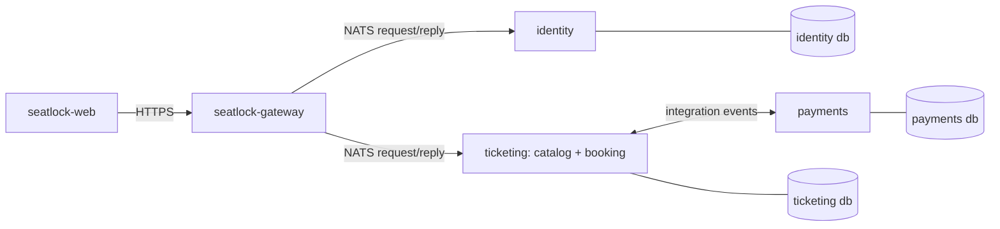
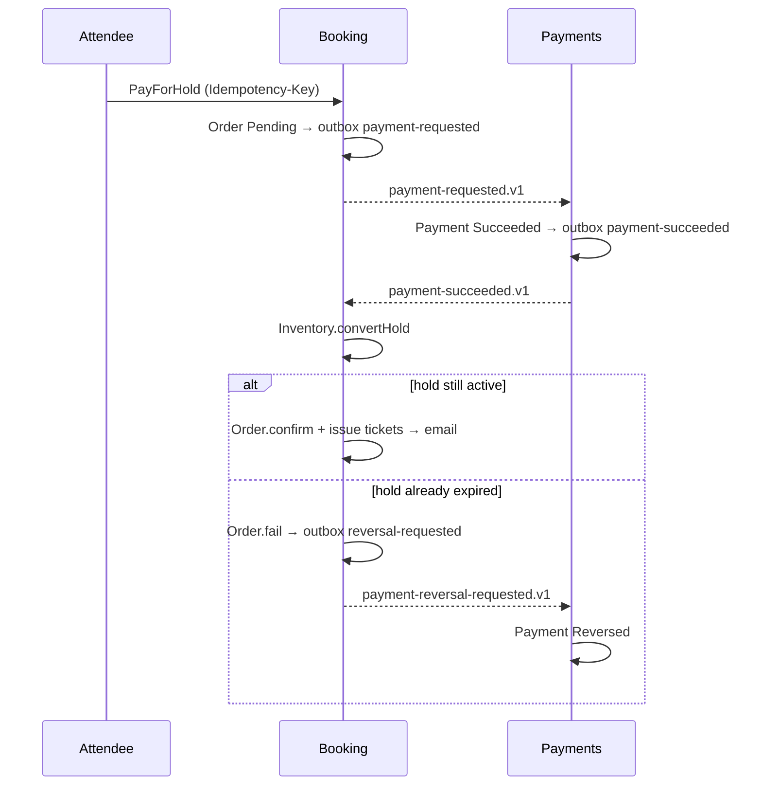

# SeatLock context map
Status: approved   Date: 2026-11-04   Brief: [SeatLock MVP](../briefs/2026-11-03-seatlock-mvp.md)

## 1. Event storming (time order, past tense)
Names become class and message names in code, so correct them here before any code exists.

| # | Domain event | Caused by command | Actor | Context |
|---|---|---|---|---|
| 1 | `UserRegistered` | `RegisterUser` | Visitor | Identity |
| 2 | `ExistingAccountRegistrationAttempted` | `RegisterUser` (email taken) | Visitor | Identity |
| 3 | `UserSignedIn` | `SignIn` | User | Identity |
| 4 | `RefreshTokenRotated` | `RotateRefreshToken` | User | Identity |
| 5 | `RefreshTokenReuseDetected` → `SessionRevoked` | `RotateRefreshToken` (old token) | Attacker or user | Identity |
| 6 | `UserSignedOut` | `SignOut` | User | Identity |
| 7 | `OrganiserRoleGranted` / `OrganiserRoleRevoked` | `GrantOrganiserRole` / `RevokeOrganiserRole` | Admin | Identity |
| 8 | `EventDrafted` | `DraftEvent` | Organiser | Catalog |
| 9 | `TicketTypeAdded` | `AddTicketType` | Organiser | Catalog |
| 10 | `EventPublished` | `PublishEvent` | Organiser | Catalog |
| 11 | `InventoryOpened` | `OpenInventory` (on `catalog.event-published.v1`) | System | Booking |
| 12 | `TicketsHeld` | `HoldTickets` | Attendee | Booking |
| 13 | `HoldExpired` | `ExpireHolds` (scheduled) | System | Booking |
| 14 | `OrderPlaced` | `PayForHold` | Attendee | Booking |
| 15 | `PaymentSucceeded` / `PaymentDeclined` | `ChargePayment` (on `booking.payment-requested.v1`) | System | Payments |
| 16 | `HoldConverted` / `HoldConversionRejected` | `ConvertHold` (on payment succeeded) | System | Booking |
| 17 | `OrderConfirmed` + `TicketsIssued` / `OrderFailed` | `ConfirmOrder` / `FailOrder` | System | Booking |
| 18 | `PaymentReversed` | `ReversePayment` (on `booking.payment-reversal-requested.v1`) | System | Payments |
| 19 | `CapacityChanged` | `ChangeCapacity` | Organiser | Booking |
| 20 | `SalesClosed` | `CloseSales` (scheduled at event start) | System | Booking |
| P2 | `SeatGridDefined`, `SeatsHeld` | `DefineSeatGrid`, `HoldSeats` | Organiser, Attendee | Booking |

## 2. Bounded contexts
| Context | Its vocabulary | Owns | Doesn't own |
|---|---|---|---|
| **Identity** | user, credential, session, refresh token, role | who you are and what role you have | anything about events or money |
| **Catalog** | event, venue, schedule, ticket type, draft, published | what is on sale and how it is described | how many tickets are left after publishing |
| **Booking** | inventory, hold, order, ticket, seat, sold out | how many are left, who holds or bought them | event descriptions, card or payment details |
| **Payments** | payment, charge, decline, reversal | whether money moved | tickets, seats, events |

**The word that proves the split:** "capacity". In Catalog it's a number the organiser types into a form. In Booking it's a rule that `held + sold <= capacity`. After publishing, only Booking can check that rule, so **Booking owns capacity after publishing**. Catalog's number is just the starting value.

## 3. Contexts → services (2–3 services, plus the gateway)
Checklist from the `domain-model` skill: different language and owner, can fail on its own, owns its data, talks only through messages.

| Service repo | Contexts | Database (one Postgres server locally) | Checklist |
|---|---|---|---|
| `seatlock-gateway` | none (the HTTP edge) | none | The only public process. Verifies JWTs, rate limits, parses with Zod, then forwards to services over NATS |
| `seatlock-identity` | Identity | `identity` | ✅ all four. If it's down, sign-in fails, but existing access tokens still work, so browsing and buying continue |
| `seatlock-ticketing` | **Catalog + Booking**, as two separate modules | `ticketing`, with Postgres schemas `catalog` and `booking` | Catalog fails the "own failure" test: without Booking, a listing means little. It stays a module for now |
| `seatlock-payments` | Payments | `payments` | ✅ all four. If it's down, holds still work and orders stay Pending until it recovers |

**Rule that keeps extraction cheap:** Catalog and Booking talk to each other only through integration events (outbox → NATS), never through direct calls or a shared table, even though they run in the same process. Moving Catalog into `seatlock-catalog` later becomes a deployment change, not a rewrite. That's planned as a stretch exercise.

**Emails:** there's no notification service in the MVP. Each service sends its own emails through a `Mailer` port (SMTP → Mailpit). A separate `seatlock-notifications` service is a stretch exercise.

## 4. Relationships
- **Identity → everyone (published language: JWT claims).** Identity signs access tokens with a private key, and the gateway verifies them with the public key. Services receive the verified `userId` and roles from the gateway and never parse tokens themselves.
- **Catalog → Booking (upstream → downstream).** Booking copies what it needs from `catalog.event-published.v1` into its own tables.
- **Booking ↔ Payments (partners in a saga).** Each listens to the other's events. Neither calls the other directly.
- **Booking → Catalog (listing projection).** Catalog keeps remaining-ticket counts for the public listing from `booking.availability-changed.v1`.

## 5. Integration events (published, versioned in `seatlock-contracts`)
| Subject | Publisher → consumer | Payload (summary) |
|---|---|---|
| `catalog.event-published.v1` | Catalog → Booking | eventId, organiserId, salesCloseAt, ticketTypes[{ticketTypeId, name, unitPriceSen, capacity}] |
| `booking.availability-changed.v1` | Booking → Catalog | eventId, ticketTypeId, remaining, occurredAt |
| `booking.payment-requested.v1` | Booking → Payments | orderId, attemptId, amountSen, currency |
| `payments.payment-succeeded.v1` | Payments → Booking | paymentId, orderId, attemptId |
| `payments.payment-declined.v1` | Payments → Booking | paymentId, orderId, attemptId, reason |
| `booking.payment-reversal-requested.v1` | Booking → Payments | paymentId, orderId |
| `payments.payment-reversed.v1` | Payments → Booking | paymentId, orderId |

Every message carries a `messageId` (UUID, for idempotent consumers) and a `correlationId` (for tracing).

## 6. The payment saga (process manager in Booking)
Each step changes **one aggregate in one transaction** and writes its outgoing event to the outbox in that same transaction.

**Why the race is safe:** "expire hold" and "convert hold" both change the same Inventory aggregate, so the database lets only one of them win. A converted hold can't expire, and an expired hold can't be converted.

## 7. Questions for `deep-plan` (verify with `fresh-docs`, may become ADRs; ADR numbers are given in the order ADRs are written)
1. **Durable delivery:** core NATS drops messages when no subscriber is listening, but the outbox pattern needs at-least-once delivery. That means **NATS JetStream**. Check whether the NestJS 12 NATS transport supports JetStream, or whether we write a JetStream consumer in `infrastructure/messaging`. → ADR
2. **Hot counter under criterion 18:** optimistic locking with retries vs a single conditional `UPDATE … WHERE held + sold + n <= capacity`. Build both, measure them with k6, and keep the winner. → ADR
3. **One database, two schemas in ticketing:** confirm Prisma 7 support for multiple Postgres schemas.
4. **Contracts distribution:** GitHub Packages vs git tags for `seatlock-contracts`. → ADR
5. **Gateway → services trust:** NATS user accounts with per-service subject permissions, so a compromised service can't impersonate another.

## Context models
- [Identity](identity/mvp.md) · [Catalog](catalog/mvp.md) · [Booking](booking/mvp.md) · [Payments](payments/mvp.md)
