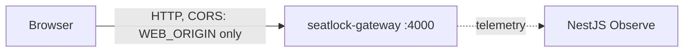

# MVP roadmap - SeatLock
Goal: an event ticketing platform where attendees hold and buy tickets safely, built as production-grade Next.js and NestJS microservices.   Last updated: 2026-11-05

| # | Feature | Repo / service | Status | Walkthrough |
|---|---|---|---|---|
| 01 | Gateway skeleton (health, env validation, helmet, CORS) | backend:gateway | ✅ done | [01-gateway-skeleton](../../seatlock-gateway/docs/walkthroughs/01-gateway-skeleton.md) |
| 02 | To be planned: Phase 1, accounts (see the [brief](briefs/2026-11-03-seatlock-mvp.md)) | to decide | ⏳ next | - |

## Architecture today

Planned: the gateway talks to identity, ticketing and payments over NATS (see the [context map](domain/context-map.md)).

## Concepts covered so far
- Feature modules, NodeAdapter in tests, config validated at boot, typed config, helmet, CORS: [walkthrough 01](../../seatlock-gateway/docs/walkthroughs/01-gateway-skeleton.md)

## Future ideas (not in the MVP)
- Try NestJS Mau (NestJS's hosted deployment platform) as a comparison with Oracle Cloud.
